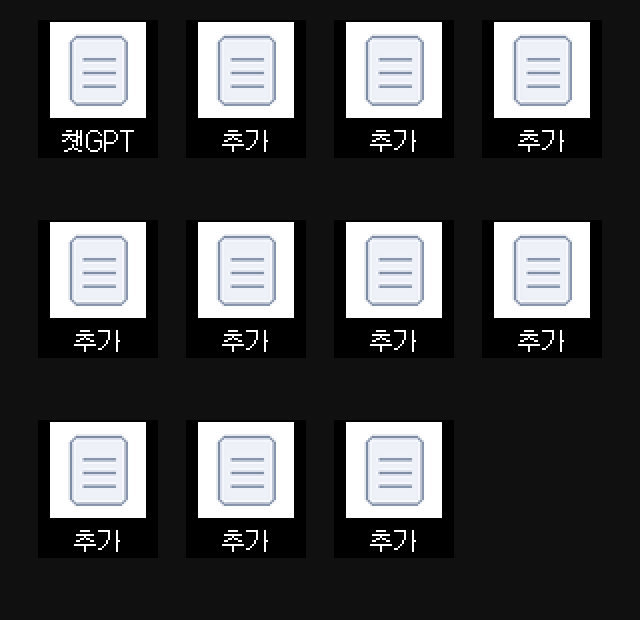

# AULA L99 Korean Localization & Stream Deck Mod

### 독거미 AULA L99 한글화 및 스트림덱 모드 추가

> **AI 개발 안내:** 이 프로젝트의 코딩에는 **GPT 6.1 SOL**을 사용했으며, GitHub 소개와 문서도 GPT로 작성했습니다. 적용할 때도 GPT와 함께 코드·파일 해시·기기 연결을 확인하며 진행하는 방식을 권장합니다. AI 안내가 모든 하드웨어의 호환성을 보장하지는 않습니다. 개발 대화에서 확인한 과거 토큰 사용량은 **79,943,850 토큰**(2026-11-13 09:35:18 KST, 캐시 입력 포함)이며, 최종 누적값은 아닙니다.

Windows 편집기와 AULA L99 디스플레이용 통합 화면 리소스입니다. 중국어 메뉴를 한국어로 바꾸고, 홈 화면에 스트림덱 진입 버튼과 11개의 사용자 바로가기, 뒤로가기를 추가합니다. 영문 메뉴는 유지하며 스트림덱 영역의 한글·영문 이름은 픽셀 글꼴로 표시합니다.

**비공개 검토용 배포.** 이전 한글화 전용 게시본·작업 이력은 포함하지 않습니다. 이 저장소는 통합 프로그램과 기본 설정으로 다시 생성한 화면 파일만 다룹니다.



## 주요 기능

- 파일·폴더·프로그램·바로가기 또는 HTTP/HTTPS 주소 실행
- 11개 버튼의 이름과 아이콘 편집, Windows 기본 아이콘 추출, 사용자 이미지 지정
- 한글화·스트림덱·글꼴·아이콘을 함께 적용하는 **펌웨어 적용**
- 전용 영역 384KB만 기록하는 **아이콘 적용** 및 적용 전후 CRC 검증
- 앱 실행 시 자동 연결, 적용 후 연결 복귀, 트레이 이동과 완전 종료 선택
- 선택 가능한 Windows 로그인 시 자동 시작

## 사용 방법

1. Releases의 Windows 포터블 ZIP을 내려받아 **폴더 전체**를 압축 해제합니다.
2. `L99StreamDeck.exe`를 실행하고 이름·경로·아이콘을 지정한 뒤 **설정 저장**을 누릅니다.
3. 처음 설치하거나 전체 화면 구성을 바꿀 때는 **펌웨어 적용**을 누릅니다. USB 모드에서 Fn+스페이스를 약 5초 눌러 화면을 끄고 기본 업데이터의 **Start**를 누릅니다. 약 10분 소요됩니다.
4. **100%·OK**를 확인한 다음 업데이터를 닫고 키보드를 껐다 켭니다.
5. 이후 이름·아이콘만 바꿀 때는 **아이콘 적용**을 사용합니다. 같은 방법으로 화면을 끄고 진행하며, 전체 검증 포함 약 2~3분 걸립니다. 완료 안내 후 키보드를 다시 켭니다.

실행 경로나 웹 주소만 바꿨다면 **설정 저장**만 하면 됩니다. 펌웨어나 아이콘을 다시 기록할 필요가 없습니다. 기본 업데이터는 제조사 1.31 원본이며 실험용 고속 수정본은 포함하지 않습니다.

최소화하면 트레이에서 연결을 유지합니다. X는 트레이 이동·완전 종료·취소를 묻습니다. 전체 펌웨어 적용 중에는 연결을 끄고, 업데이터 창이 닫히면 다시 켭니다. 아이콘 적용은 검증 성공 후 자동으로 연결을 켭니다.

## 입력 방식과 제약

홈의 스트림덱 진입은 넘패드 `-`, 뒤로가기는 넘패드 `+` 신호를 사용합니다. 스트림덱 안에서는 왼쪽 위부터 `0~9`, `/` 순서로 11개 버튼을 처리합니다. **NumLock을 켜세요.** 연결 중 `-`/`+`는 예약되며, 스트림덱 모드에서 물리 넘패드 숫자·나누기도 바로가기로 처리됩니다. 뒤로가기로 모드를 끝내면 숫자·나누기는 일반 입력으로 돌아갑니다. 완전 종료하면 예약을 해제합니다.

PC 연결 프로그램이 켜져 있어야 앱 실행이 동작합니다. 화면만으로 Windows 프로그램을 직접 실행하지는 않습니다. USB 모드의 한 대의 L99(키보드 표시 버전 1.29)에서 개발·시험했으며 다른 개정판이나 무선 모드까지 검증한 것은 아닙니다.

## 데이터 보존과 개인정보

개인 IP·날씨 지역·좌표·개인 경로·설정·사용자 아이콘·사진·통신 로그·원본 개발 대화는 포함하지 않습니다. 지역 설정을 사용했던 실시간 날씨·습도 도우미도 포함하지 않습니다. 기본 화면의 실시간 정보 메뉴에 PC/날씨 값을 계속 공급하는 기능은 별도 도우미가 필요합니다.

프로그램의 사용자 설정과 아이콘은 실행 폴더의 `data/`에 저장됩니다. Git에서는 제외합니다. 자동 위치 조회·원격 로그 수집·날씨 API 호출은 하지 않습니다. 사용자가 지정한 웹 주소는 기본 브라우저로 엽니다.

아이콘 적용은 전용 영역만 기록하고 전체 CRC를 검증합니다. **전체 적용은 배포 기준 화면을 다시 기록하므로 기기에 저장한 사용자 사진·GIF·배경을 덮어쓸 수 있습니다.** 업로드한 파일은 기기에서 읽어낸 백업이 아닙니다. 복구용 전체 패키지를 확보하고, 기록 중 USB·전원을 유지하세요. 전송 실패 시 자동으로 반복 기록하지 않습니다.

## 소스 실행과 빌드

Windows Python 3.10 이상에서:

```powershell
python -m pip install -r requirements.txt
python app/main.py
python app/test_boot_icons.py
```

포터블 EXE 생성:

```powershell
python -m pip install -r requirements-build.txt
python build.py
```

`app/assets/private-layout.zip`은 개인 설정 없이 생성한 기본 통합 화면입니다. 프로그램은 내부 파일의 SHA-256을 검증합니다. 처음 생성한 기본 배포 리소스 자체는 기기에 새로 기록해 시험하지 않았으며, 같은 구성·기록 경로가 개발 기기에서 확인되었습니다. 자세한 절차는 [사용 안내](app/USAGE.ko.md)를 참고하세요.

## 출처

중국어 화면을 러시아어로 바꾼 선행 프로젝트 [softce/aula-l99-research](https://github.com/softce/aula-l99-research) ([러시아어 문서](https://github.com/softce/aula-l99-research/blob/main/README.ru.md))의 리소스 분석을 참고했습니다. USB 화면 전송 연구는 [gavindi/Aula_L99_Linux](https://github.com/gavindi/Aula_L99_Linux), 한글·영문 비트맵 글꼴은 [quiple/galmuri](https://github.com/quiple/galmuri)를 참고·사용했습니다.

비공식 개조 프로젝트로 AULA 또는 Elgato와 제휴하지 않습니다. 소스 라이선스와 제조사 리소스·업데이터 및 글꼴의 권리 범위는 [THIRD_PARTY.md](THIRD_PARTY.md)를 참고하세요.
