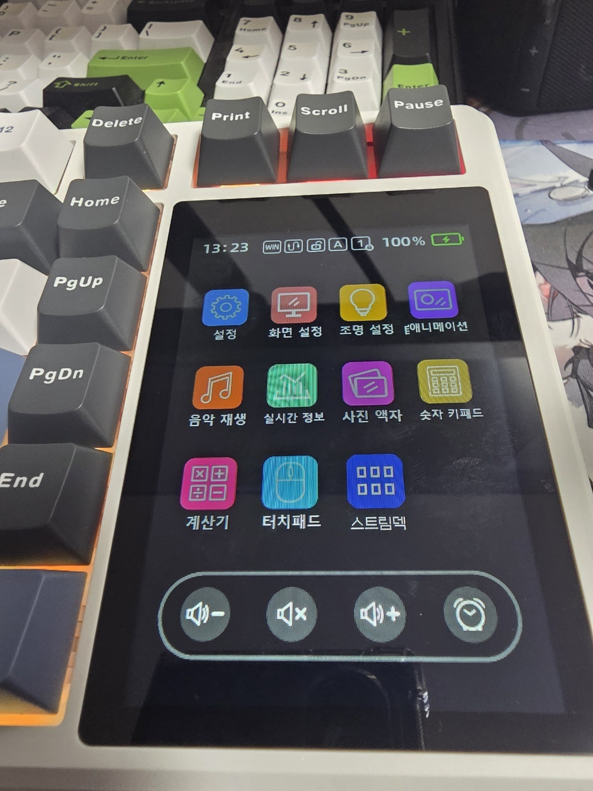
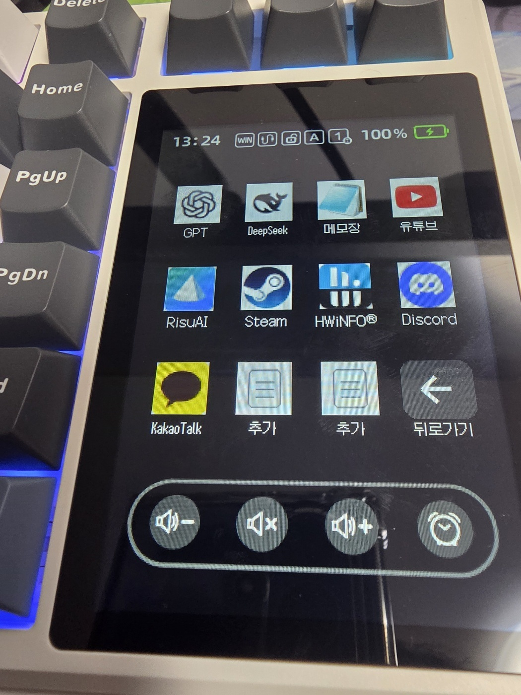
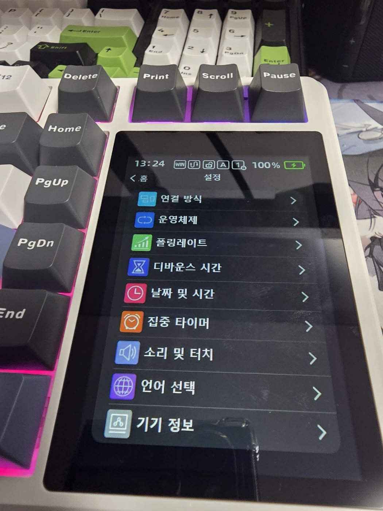
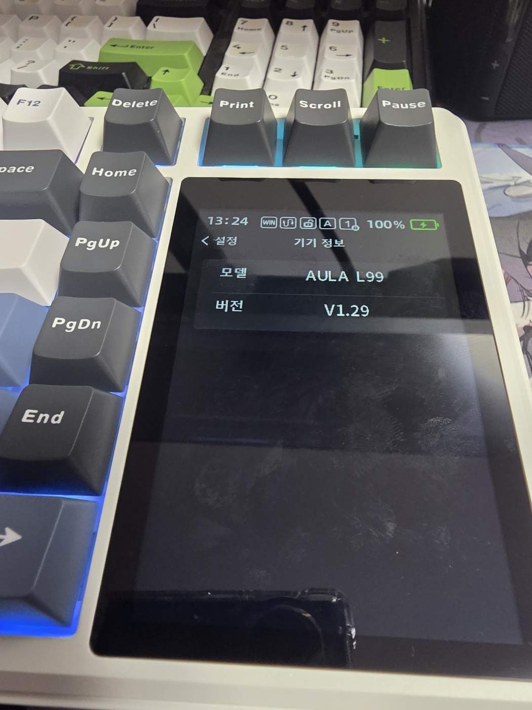
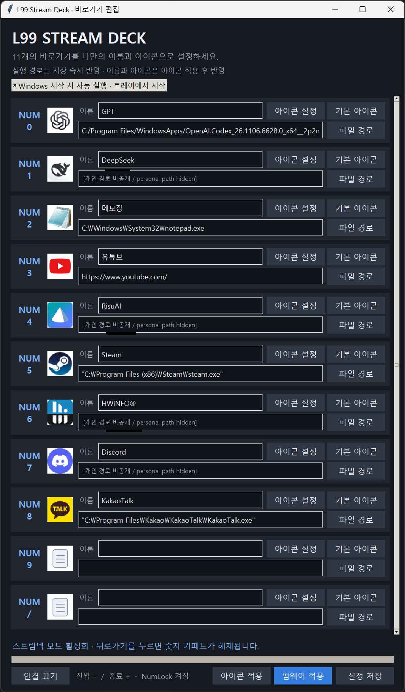

# AULA L99 Keyboard — Korean Localization & Stream Deck Mod

### 독거미 AULA L99 한글화 및 스트림덱 모드 추가

## AI 개발 안내 및 총 토큰 사용량

**이 프로그램은 GPT SOL 6.1을 사용해 작성되었습니다. GitHub 소개와 문서도 GPT로 작성했습니다.**

코드를 GPT와 함께 작성했으므로, 적용할 때도 GPT와 코드·파일 해시·기기 연결을 검토하며 진행하는 방식을 권장합니다. AI 안내가 모든 하드웨어의 호환성을 보장하지는 않습니다.

이 프로젝트 개발 대화의 로컬 사용량 기록에서 확인한 **총 누적 사용량은 285,153,587 토큰**입니다.

| 항목 | 토큰 수 |
|---|---:|
| 입력 (캐시 포함) | 284,767,832 |
| 입력 중 캐시 재사용 | 282,533,632 |
| 입력 중 캐시 외 부분 | 2,234,200 |
| 출력 | 385,755 |
| **총 사용량 (입력 + 출력)** | **285,153,587** |

기준: **2026-11-14 13:58:50 KST**. 이후 대화와 수정에 사용되는 토큰은 포함하지 않은 스냅샷입니다. 캐시는 입력에 이미 포함되므로 총량에 다시 더하지 않습니다. 반복 전달된 문맥·캐시를 포함한 처리량이며 새로 작성한 글의 분량이나 비용을 뜻하지 않습니다. 원본 대화·사용량 로그·개인정보는 게시하지 않습니다.

Windows 편집기와 AULA L99 디스플레이용 통합 화면 리소스입니다. 중국어 메뉴를 한국어로 바꾸고, 홈 화면에 스트림덱 진입 버튼과 11개의 사용자 바로가기, 뒤로가기를 추가합니다. 영문 메뉴는 유지하며 스트림덱 영역의 한글·영문 이름은 픽셀 글꼴로 표시합니다.

**초기 공개 시험용 배포.** 이전 한글화 전용 게시본·작업 이력은 포함하지 않습니다. 이 저장소는 통합 프로그램과 기본 설정으로 다시 생성한 화면 파일만 다룹니다.

## 실기기 및 프로그램 화면 / Photos & Screenshots

공개용 사진은 EXIF 등 메타데이터를 제거했고, 프로그램 화면의 개인 경로는 가렸습니다. 실기기 사진은 사용자가 구성한 바로가기 예시이며 배포 기본 설정과는 다를 수 있습니다.

Metadata was removed from the published images, and personal paths were redacted in the editor screenshot. Device photos show a user's shortcut configuration, which may differ from the distribution defaults.

| 홈 화면 / Home | 스트림덱 / Stream Deck |
|---|---|
|  |  |

| 한글 설정 / Korean Settings | 기기 정보 / Device Information |
|---|---|
|  |  |

### Windows 편집기 / Windows Editor



## 주요 기능

- 파일·폴더·프로그램·바로가기 또는 HTTP/HTTPS 주소 실행
- 11개 버튼의 이름과 아이콘 편집, Windows 기본 아이콘 추출, 사용자 이미지 지정
- 한글화·스트림덱·글꼴·아이콘을 함께 적용하는 **펌웨어 적용**
- 전용 영역 384KB만 기록하는 **아이콘 적용** 및 적용 전후 CRC 검증
- 앱 실행 시 자동 연결, 적용 후 연결 복귀, 트레이 이동과 완전 종료 선택
- 선택 가능한 Windows 로그인 시 자동 시작

## 사용 방법

1. Releases의 Windows 포터블 ZIP을 내려받아 **폴더 전체**를 압축 해제합니다.
2. `L99StreamDeck.exe`를 실행하고 이름·경로·아이콘을 지정한 뒤 **설정 저장**을 누릅니다.
3. 처음 설치하거나 전체 화면 구성을 바꿀 때는 **펌웨어 적용**을 누릅니다. USB 모드에서 Fn+스페이스를 약 5초 눌러 화면을 끄고 기본 업데이터의 **Start**를 누릅니다. 약 10분 소요됩니다.
4. **100%·OK**를 확인한 다음 업데이터를 닫고 키보드를 껐다 켭니다.
5. 이후 이름·아이콘만 바꿀 때는 **아이콘 적용**을 사용합니다. 같은 방법으로 화면을 끄고 진행하며, 전체 검증 포함 약 2~3분 걸립니다. 완료 안내 후 키보드를 다시 켭니다.

실행 경로나 웹 주소만 바꿨다면 **설정 저장**만 하면 됩니다. 펌웨어나 아이콘을 다시 기록할 필요가 없습니다. 기본 업데이터는 제조사 1.31 원본이며 실험용 고속 수정본은 포함하지 않습니다.

최소화하면 트레이에서 연결을 유지합니다. X는 트레이 이동·완전 종료·취소를 묻습니다. 전체 펌웨어 적용 중에는 연결을 끄고, 업데이터 창이 닫히면 다시 켭니다. 아이콘 적용은 검증 성공 후 자동으로 연결을 켭니다.

## 입력 방식과 제약

홈의 스트림덱 진입은 넘패드 `-`, 뒤로가기는 넘패드 `+` 신호를 사용합니다. 스트림덱 안에서는 왼쪽 위부터 `0~9`, `/` 순서로 11개 버튼을 처리합니다. **NumLock을 켜세요.** 연결 중 `-`/`+`는 예약되며, 스트림덱 모드에서 물리 넘패드 숫자·나누기도 바로가기로 처리됩니다. 뒤로가기로 모드를 끝내면 숫자·나누기는 일반 입력으로 돌아갑니다. 완전 종료하면 예약을 해제합니다.

PC 연결 프로그램이 켜져 있어야 앱 실행이 동작합니다. 화면만으로 Windows 프로그램을 직접 실행하지는 않습니다. USB 모드의 한 대의 L99(키보드 표시 버전 1.29)에서 개발·시험했으며 다른 개정판이나 무선 모드까지 검증한 것은 아닙니다.

## 데이터 보존과 개인정보

개인 IP·날씨 지역·좌표·개인 경로·설정 파일·사용자 아이콘 원본·기기에 저장한 사진/GIF 원본·통신 로그·원본 개발 대화는 포함하지 않습니다. 지역 설정을 사용했던 실시간 날씨·습도 도우미도 포함하지 않습니다. 기본 화면의 실시간 정보 메뉴에 PC/날씨 값을 계속 공급하는 기능은 별도 도우미가 필요합니다.

프로그램의 사용자 설정과 아이콘은 실행 폴더의 `data/`에 저장됩니다. Git에서는 제외합니다. 자동 위치 조회·원격 로그 수집·날씨 API 호출은 하지 않습니다. 사용자가 지정한 웹 주소는 기본 브라우저로 엽니다.

아이콘 적용은 전용 영역만 기록하고 전체 CRC를 검증합니다. **전체 적용은 배포 기준 화면을 다시 기록하므로 기기에 저장한 사용자 사진·GIF·배경을 덮어쓸 수 있습니다.** 업로드한 파일은 기기에서 읽어낸 백업이 아닙니다. 복구용 전체 패키지를 확보하고, 기록 중 USB·전원을 유지하세요. 전송 실패 시 자동으로 반복 기록하지 않습니다.

## 소스 실행과 빌드

Windows Python 3.10 이상에서:

```powershell
python -m pip install -r requirements.txt
python app/main.py
python app/test_boot_icons.py
```

포터블 EXE 생성:

```powershell
python -m pip install -r requirements-build.txt
python build.py
```

`app/assets/private-layout.zip`은 개인 설정 없이 생성한 기본 통합 화면입니다. 프로그램은 내부 파일의 SHA-256을 검증합니다. 처음 생성한 기본 배포 리소스 자체는 기기에 새로 기록해 시험하지 않았으며, 같은 구성·기록 경로가 개발 기기에서 확인되었습니다. 자세한 절차는 [사용 안내](app/USAGE.ko.md)를 참고하세요.

## 출처

한글화 작업에는 중국어 화면을 러시아어로 번역한 선행 프로젝트 [softce/aula-l99-research](https://github.com/softce/aula-l99-research)의 **[러시아어 문서 README.ru.md](https://github.com/softce/aula-l99-research/blob/main/README.ru.md)와 화면 리소스 분석을 참고했습니다.** 한국어 번역과 스트림덱 기능은 이를 참고해 별도로 구현했습니다.

**English:** The Korean localization was developed with reference to the **[Russian documentation (README.ru.md)](https://github.com/softce/aula-l99-research/blob/main/README.ru.md)** and display-resource analysis from [softce/aula-l99-research](https://github.com/softce/aula-l99-research), an earlier project that translated the Chinese interface into Russian. The Korean translation and Stream Deck functionality were implemented separately, informed by that work.

 USB 화면 전송 연구는 [gavindi/Aula_L99_Linux](https://github.com/gavindi/Aula_L99_Linux), 한글·영문 비트맵 글꼴은 [quiple/galmuri](https://github.com/quiple/galmuri)를 참고·사용했습니다.

비공식 개조 프로젝트로 AULA 또는 Elgato와 제휴하지 않습니다. 소스 라이선스와 제조사 리소스·업데이터 및 글꼴의 권리 범위는 [THIRD_PARTY.md](THIRD_PARTY.md)를 참고하세요.


---

## English

### AULA L99 Keyboard — Korean Localization & Stream Deck Mod

**This program was written using GPT SOL 6.1. The GitHub project description and documentation were also written with GPT.** Because the code was developed with GPT, we recommend reviewing the code, file hashes and device connection with GPT when applying the modifications. AI assistance does not guarantee compatibility with every hardware revision.

**Recorded cumulative token usage: 285,153,587 tokens**, as of **2026-11-14 13:58:50 KST**.

| Category | Tokens |
|---|---:|
| Input, including cached input | 284,767,832 |
| Cached portion of input | 282,533,632 |
| Uncached portion of input | 2,234,200 |
| Output | 385,755 |
| **Total: input + output** | **285,153,587** |

This is a snapshot of the local development conversation's cumulative usage. Later work is not included. Cached input is already part of input and must not be added again. The figures include repeatedly supplied context and cache reuse; they do not represent newly written text or monetary cost. Raw conversations, usage logs and personal information are not published.

### Overview and features

A Windows editor and integrated display resources for the AULA L99. The Chinese menus are localized into Korean, while English menus remain available. The home screen gains a Stream Deck entry button, a page with 11 customizable shortcuts and a back button. Korean and English labels within the Stream Deck area use a pixel font.

This is an **initial experimental release** containing the integrated application and display resources rebuilt with factory defaults. It does not include the previous localization-only package or its development history.

- Launch programs, files, folders, shortcuts and HTTP/HTTPS addresses.
- Customize the names and icons of 11 buttons; extract Windows file icons or select an image.
- **펌웨어 적용 (Apply firmware):** apply Korean localization, Stream Deck mode, font changes and configured icons together using the original manufacturer updater.
- **아이콘 적용 (Apply icons):** write only the reserved 384 KB icon region, with CRC checks before and after the operation.
- Automatically connect when the app starts, resume the connection after applying changes, and continue operating in the system tray.
- Optionally start with Windows sign-in. Closing the window offers tray mode, full exit or cancel.

### Installation and use

1. Download the portable Windows ZIP from Releases and extract the **entire folder**.
2. Run `L99StreamDeck.exe`, edit names, targets and icons, then select **설정 저장 (Save settings)**.
3. For the initial installation or a complete layout change, choose **펌웨어 적용 (Apply firmware)**. Use USB mode, hold Fn+Space for approximately five seconds to turn off the display, then click **Start** in the original updater. A full update takes approximately ten minutes.
4. Wait for **100% / OK**, close the updater and restart the keyboard.
5. For subsequent name/icon changes, use **아이콘 적용 (Apply icons)** with the display turned off in the same way. Including full verification, this takes approximately two to three minutes. Restart the keyboard after the completion message.

Changing only a launch target or web address requires **Save settings**, without rewriting display resources. The full-update path uses the original manufacturer updater 1.31; the experimental fast updater is not included.

Minimizing keeps the connection running in the tray. The X button offers tray mode, full exit and cancel. During a full update, the connection is stopped and resumes when the updater window closes. After an icon update, it resumes following successful verification. Closing the updater alone is not treated as proof of a successful firmware update.

### Input mapping and compatibility

Entering Stream Deck mode emits numpad `-`; the back button emits numpad `+`. The 11 shortcut tiles map to numpad `0–9` and `/`, from left to right and top to bottom. **Enable NumLock.** While connected, numpad `-` and `+` are reserved. In Stream Deck mode, the physical numpad digits and divide key also trigger the assigned shortcuts. Leaving the mode restores ordinary digit/divide input; a full application exit releases the hotkeys.

The PC application must remain running to launch Windows applications. The display does not launch them independently. Development and hardware testing used one L99 in USB mode, with keyboard-reported version 1.29. Other revisions and wireless operation are not verified.

### Privacy and data preservation

The release excludes personal IP addresses, weather locations and coordinates, personal paths, local configuration files, standalone custom-icon files, photos/GIFs stored on the device, communication logs and development conversations. The weather/humidity helper that previously used a personal location is also excluded. Continuously supplying PC/weather readings to the existing real-time information screen requires a separate helper.

User settings and icons are saved locally under `data/`, which is ignored by Git. The application does not automatically locate the user, collect remote logs or call a weather API. User-configured web addresses open in the default browser.

Icon updates target only the reserved icon region and verify the complete image CRC. **A full update writes the distribution's reference image and may overwrite photos, GIFs or backgrounds saved on the device.** The distributed image is not a readback backup of a keyboard. Keep a full recovery package available and maintain USB power throughout an update. Failed transfers are not automatically retried.

### Running and building from source

On Windows with Python 3.10 or newer:

```powershell
python -m pip install -r requirements.txt
python app/main.py
python app/test_boot_icons.py
```

To build a portable executable:

```powershell
python -m pip install -r requirements-build.txt
python build.py
```

`app/assets/private-layout.zip` contains the integrated reference image generated without personal settings. The app checks its SHA-256. This freshly rebuilt factory-default distribution image has not itself been flashed for a new hardware test; the corresponding layout and transfer paths were tested on the development device. See [the usage guide](app/USAGE.ko.md) for further details.

### Acknowledgments

The Korean localization references the **[Russian documentation (README.ru.md)](https://github.com/softce/aula-l99-research/blob/main/README.ru.md)** and resource-format analysis of [softce/aula-l99-research](https://github.com/softce/aula-l99-research), which translated the Chinese display interface into Russian. The Korean translation and Stream Deck functionality were implemented separately, informed by this prior research.

USB display-transfer research: [gavindi/Aula_L99_Linux](https://github.com/gavindi/Aula_L99_Linux). Korean/Latin bitmap fonts: [quiple/galmuri](https://github.com/quiple/galmuri).

This is an unofficial modification project, unaffiliated with AULA or Elgato. Source licensing and the separate rights applicable to manufacturer resources, the updater and fonts are documented in [THIRD_PARTY.md](THIRD_PARTY.md).
